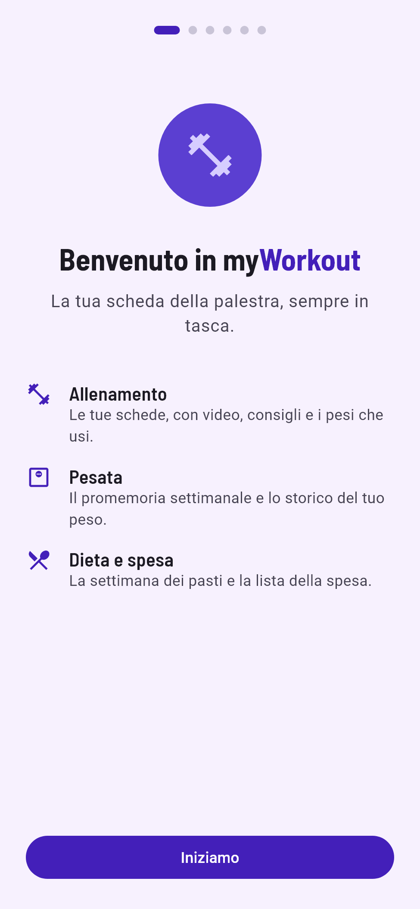
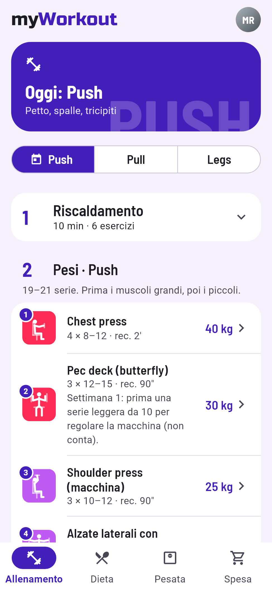
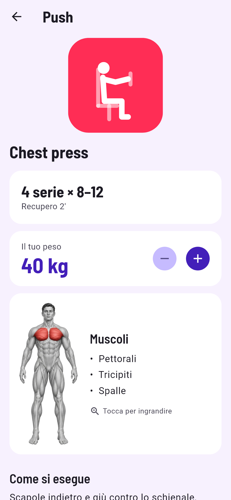
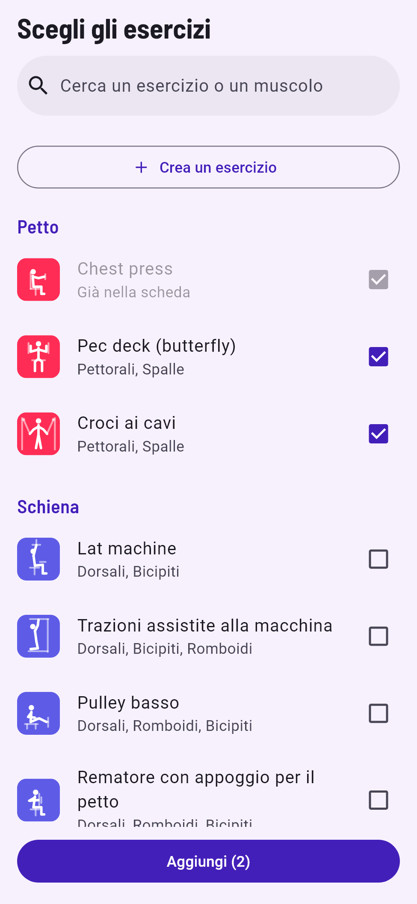
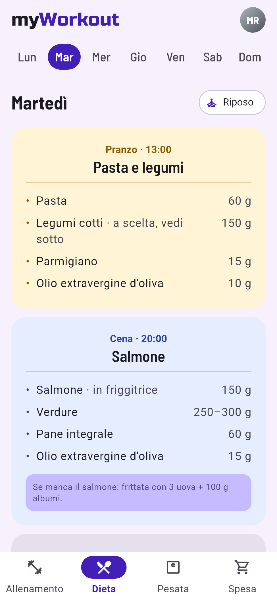
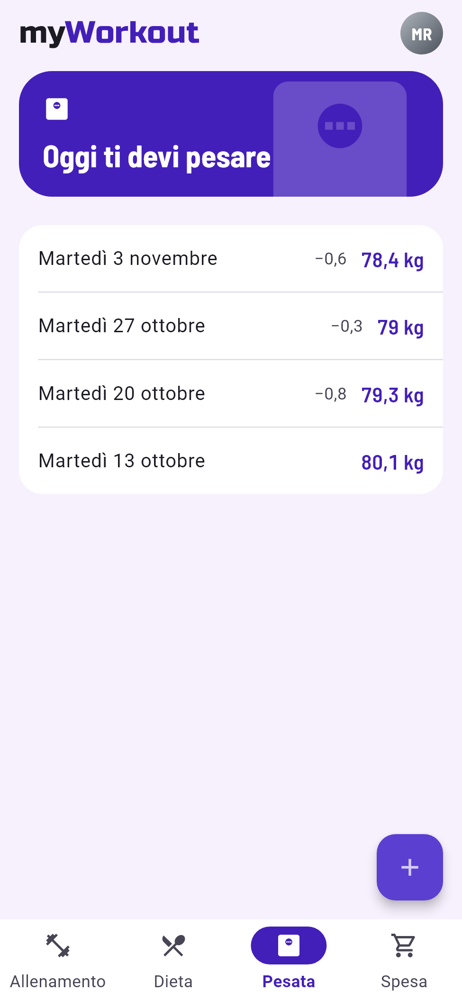

# myWorkout

App Flutter per la palestra: scheda di allenamento, dieta settimanale e pesata settimanale, tutto in un'unica app, senza account e senza server.

> **Stato:** in sviluppo, verso la prima versione di prova (0.1.0). L'app è usabile: al primo avvio crei la tua scheda, poi aggiungi dieta e pesate. Manca ancora l'editor della lista della spesa.

<table>
  <tr>
    <td align="center"><br><sub>Primo avvio</sub></td>
    <td align="center"><br><sub>L'allenamento di oggi</sub></td>
    <td align="center"><br><sub>Esercizio, peso e muscoli</sub></td>
  </tr>
  <tr>
    <td align="center"><br><sub>Libreria per gruppo muscolare</sub></td>
    <td align="center"><br><sub>La dieta della settimana</sub></td>
    <td align="center"><br><sub>Pesata settimanale</sub></td>
  </tr>
</table>

## Cosa fa

- **Allenamento** — le tue schede (A/B/C, Push/Pull/Legs o i nomi che vuoi) che si alternano nei giorni scelti, con il giorno di turno sempre in cima. Ogni esercizio ha istruzioni, consigli, i muscoli coinvolti, spesso un video, e il peso che usi (salvato sul telefono).
- **Libreria** — 46 esercizi divisi per gruppo muscolare (pesi, macchinari, addominali, cardio, riscaldamento), con ricerca. Se manca qualcosa, crei un esercizio tuo. Ogni esercizio si misura nel modo giusto: serie × ripetizioni, a tempo (il plank) o in minuti con velocità, pendenza o livello (tapis roulant, cyclette, stair climber).
- **Dieta** — la settimana dei pasti, giorno per giorno: la scrivi tu nell'app (pasti, alimenti e quantità), con "uguale tutti i giorni" e "copia il giorno".
- **Pesata** — promemoria nel giorno che scegli e storico delle pesate con le differenze.
- **Spesa** — in arrivo: per ora la tab è vuota.

Scheda, dieta e giorno della pesata si cambiano quando vuoi dal cerchio del profilo. Tutti i tuoi dati restano **solo sul telefono**.

## Installazione

- **Android**: a breve l'APK nella pagina [Releases](../../releases) (per installarlo serve consentire l'installazione da "origini sconosciute").
- Google Play: in arrivo.
- **iOS**: l'app non è sull'App Store. La cartella `ios/` c'è, quindi chi ha un Mac (o un servizio di build nel cloud) può compilarla per il proprio iPhone.

## Sviluppo

Serve [Flutter](https://docs.flutter.dev/get-started/install) (Dart 3.13 o successivo).

```bash
flutter pub get
flutter run
```

Prima di ogni commit:

```bash
flutter analyze
flutter test
```

Gli screenshot qui sopra li disegna l'app stessa, senza emulatore:

```bash
flutter test tool/screenshots/readme_screenshots_test.dart
```

### Struttura

```
lib/
├── data/       # lettura dei JSON e salvataggi sul telefono
├── models/     # esercizi, scheda, dieta, spesa, pesate
├── features/   # una cartella per tab ed editor: workout, plan_editor, diet, diet_editor, onboarding…
└── widgets/    # componenti condivisi
assets/data/    # exercises.json: la libreria degli esercizi
test/fixtures/  # scheda, dieta e spesa di prova per i test
tool/           # anteprime degli esercizi, icona, immagini dei muscoli, screenshot
```

Più dettagli su dati e interfaccia in [docs/CONTESTO_PROGETTO.md](docs/CONTESTO_PROGETTO.md).

## Crediti

- Font [Barlow Semi Condensed](https://fonts.google.com/specimen/Barlow+Semi+Condensed), licenza SIL Open Font License ([assets/fonts/OFL.txt](assets/fonts/OFL.txt)).
- Font del logo [Russo One](https://fonts.google.com/specimen/Russo+One) di Jovanny Lemonad, licenza SIL Open Font License ([assets/fonts/RussoOne-OFL.txt](assets/fonts/RussoOne-OFL.txt)).
- Icona, anteprime degli esercizi e illustrazioni dei muscoli: realizzate per questo progetto.
- I video degli esercizi sono contenuti di terze parti (YouTube e gym80.de), incorporati e non inclusi nel repository.

## Licenza

[MIT](LICENSE)
